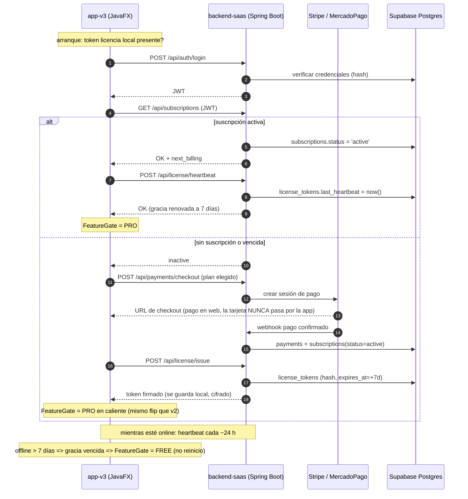

# MP3Converter SaaS v3.0.0 — Borrador arquitectónico (Fase 7)

> **Estado (Fase 9):** el backend (Fase 8, 8.1–8.5) y la APP `app-v3-saas`
> (Fase 9, 9.1–9.4) están IMPLEMENTADOS. v3 ya no es borrador: el fork de v2
> compila con branding SaaS 3.0.0, el `FeatureGate` decide por SUSCRIPCIÓN
> (heartbeat + gracia offline de 7 días, sin .lic), el diálogo de suscripción
> hace login → checkout web (la tarjeta nunca pasa por la app) → token → PRO
> en caliente, y un daemon de heartbeat re-verifica cada ~24 h. El E2E de v3
> (`AppV3SaasLifecycleE2ETest`) corre contra el backend REAL en un proceso
> hijo: register → checkout → webhook PAID → issue → PRO → heartbeat → cancel
> → FREE. Pendiente según este documento: gateways de pago reales y deploy
> (Render/Railway/Fly). El diseño de negocio queda EXACTAMENTE como fue
> especificado abajo. Este es el documento que exige el plan maestro (Fase 7)
> antes de empezar: modelo de negocio, contratos de API, tablas, ciclo de vida
> de la suscripción con tolerancia offline, decisión de infraestructura y plan
> de arranque de `app-v3-saas`.

## 1. Modelo de negocio: licencia por suscripción

v2 (freemium) demostró el pago one-shot con licencia local. v3 lo reemplaza por
una **suscripción mensual o anual validada en línea**, sobre la misma base
Supabase de v2:

| Concepto | v2 (implantado) | v3 (propuesto) |
|----------|-----------------|----------------|
| Pago | One-shot (mock) | Recurrente vía Stripe/MercadoPago reales |
| Licencia | `mp3converter.lic` local, válida para siempre | Token firmado por el backend, re-verificado en línea |
| Offline | Total (la .lic decide solo) | **7 días de gracia** tras el último heartbeat exitoso |
| Caduca | Nunca | Si la suscripción expira o se cancela |
| Tier gating | `FeatureGate` lee el archivo | `FeatureGate` lee el estado de suscripción + ventana de gracia |

El estado FREE de v3 mantiene las mismas reglas de v2 (92 kbps, watermark,
.opus bloqueado), de modo que `core` y su `QualityPolicy` se reutilizan tal cual.

## 2. Backend ligero — módulo `backend-saas` (Java 21, Spring Boot 3.x)

Nuevo módulo del repositorio, ya registrado en el build como **stub vacío**
(Fase 7, criterio del plan). Endpoints previstos:

| Método | Ruta | Propósito |
|--------|------|-----------|
| POST | `/api/auth/register` | Alta de usuario (contraseña con hash + salt, igual política que `docs/criptografia.md`) |
| POST | `/api/auth/login` | Login → **JWT** (corto, p. ej. 15 min + refresh) |
| GET  | `/api/subscriptions` | Consulta la suscripción activa del JWT |
| POST | `/api/subscriptions` | Cambiar de plan / cancelar |
| POST | `/api/payments/checkout` | Crea la sesión de pago en el gateway REAL (Stripe o MercadoPago; interfaz análoga a `PaymentGateway` de v2, con `MockPaymentGateway` para tests) |
| POST | `/api/license/issue` | Tras pago confirmado: emite **token de licencia firmado** (válido offline 7 días) |
| POST | `/api/license/heartbeat` | Verificación periódica desde la app; devuelve si la suscripción sigue activa |

Reglas heredadas del proyecto (no negociables):
- **Nunca persistir datos de tarjeta.** El checkout delega en el gateway; los
  logs solo enmascaran (`**** 1234`), como en `PaymentFlow`.
- Credenciales (BD, JWT secret, claves del gateway) solo por variables de
  entorno — patrón `SUPABASE_*` de v2: `SAAS_DB_URL/USER/PWD`, `SAAS_JWT_SECRET`.
- Anti-duplicado por `email_hash` (HMAC con secreto embebido), no correo plano.

## 3. Tablas nuevas (Supabase Postgres)

Sobre las existentes de v2 (`users`, `activations`):

```sql
plans            (id, code, price_cents, currency, period, active)
subscriptions    (id, user_id, plan_id, status, period,      -- 'monthly'|'annual'
                  started_at, next_billing, canceled_at)
payments         (id, user_id, subscription_id, gateway, external_id,
                  amount_cents, status, created_at)          -- SIN datos de tarjeta
license_tokens   (id, user_id, subscription_id, token_hash,  -- HMAC del token, jamas token plano
                  issued_at, expires_at, last_heartbeat)
```

## 4. Ciclo de vida de la suscripción (diagrama de secuencia)



La **ventana de gracia de 7 días** se calcula localmente comparando el
último heartbeat exitoso con el reloj del sistema; el token firmado lleva la
fecha de expiración para que un usuario no pueda estirarla editando archivos.

## 5. Frontend: app-v3-saas

**IMPLEMENTADO (Fase 9, 9.1–9.4).** Fork de v2 (`app-v2-freemium`), módulo
`com.casl.mp3converter.app3`, packages `com.casl.mp3converter.v3[.saas|.ui]`:
- `FeatureGate` cambió su fuente de verdad: ya no lee la `.lic`; guarda el
  token de licencia en `mp3converter.saas` (junto al .exe, nunca password/JWT)
  y re-verifica con heartbeat + tolerancia offline de 7 días; el flip a FREE
  al vencer es también **en caliente, sin reiniciar**.
- `SubscriptionDialogV3` sustituye a `PaymentDialogV2`+`ActivationDialogV2`:
  crear cuenta/login → el backend crea la sesión del gateway y la app ABRE EL
  NAVEGADOR (la tarjeta NUNCA pasa por la app; fallback: copiar la URL al
  portapapeles) → "Ya completé el pago" → `issue` → `activateWithToken` → PRO
  en caliente. Lecciones de UX de la Fase 5 aplicadas (botones consumen el
  evento, slot de estado fijo, X funcional, sin modales anidados).
- `SaasApiClient`: cliente HTTP puro `java.net.http` (cero dependencias);
  base URL por prop `mp3converter.saas.api` → env `SAAS_API_URL` →
  `http://localhost:8080`.
- `ApplicationV3.init()`: sesión local + heartbeat al arrancar, y un
  **daemon** (`startHeartbeatDaemon`) re-verifica la suscripción cada ~24 h
  en un hilo daemon que nunca lanza; `stop()` lo apaga.
- E2E `AppV3SaasLifecycleE2ETest`: backend REAL como proceso JVM hijo
  (classpath de `:backend-saas`), ciclo completo por HTTP.

## 6. Decisión de infraestructura (diferida)

- **BD:** Supabase solo Postgres — ya la tenemos en v2, mismo patrón de
  credenciales por variable de entorno.
- **Backend:** Spring Boot 3.x desplegado en Render / Railway / Fly.io
  (free tier de cada uno). Se decide **cuando se implemente** (Fase 7 quedó
  como borrador a propósito).
- **Gateway de pago real:** Stripe (checkout hosted, webhook) o MercadoPago
  (Predominante en México, país por defecto del dropdown de v2). TBD.
- **Secretos:** `SAAS_JWT_SECRET` y las claves del gateway nunca en el repo.

## 7. Plan de arranque cuando se implemente

1. ~~Completar el stub `backend-saas`~~ **hecho en Fase 8** (H2 dev / Supabase
   por env, Dockerfile).
2. ~~Contratos como tests `@SpringBootTest`~~ **hecho en Fase 8** (MockMvc).
3. ~~Migraciones SQL de las tablas nuevas~~ **hecho en Fase 8**
   (`db/migration/saas/V1__saas.sql`, portable BYTEA).
4. ~~Fork v2 → v3 y sustituir la fuente de verdad de `FeatureGate`~~
   **hecho en Fase 9** (9.1–9.4).
5. ~~E2E análogo al de la Fase 6~~ **hecho en Fase 9.4**
   (`AppV3SaasLifecycleE2ETest` contra backend real en proceso hijo).
