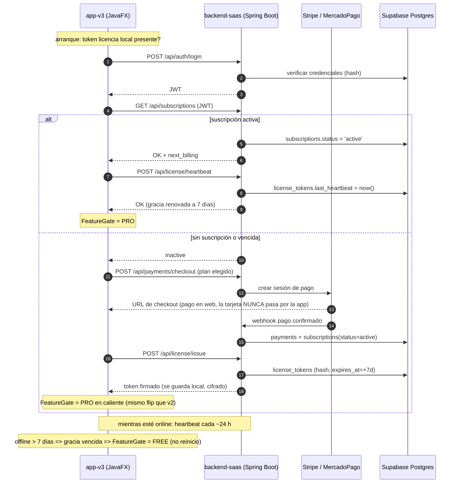

# MP3Converter SaaS v3.0.0 — Borrador arquitectónico (Fase 7)

> **Estado:** solo diseño. Nada de este documento está implementado todavía.
> Este es el documento que exige el plan maestro (Fase 7) antes de empezar:
> modelo de negocio, contratos de API, tablas, ciclo de vida de la suscripción
> con tolerancia offline, decisión de infraestructura y plan de arranque de
> `app-v3-saas`.

## 1. Modelo de negocio: licencia por suscripción

v2 (freemium) demostró el pago one-shot con licencia local. v3 lo reemplaza por
una **suscripción mensual o anual validada en línea**, sobre la misma base
Supabase de v2:

| Concepto | v2 (implantado) | v3 (propuesto) |
|----------|-----------------|----------------|
| Pago | One-shot (mock) | Recurrente vía Stripe/MercadoPago reales |
| Licencia | `mp3converter.lic` local, válida para siempre | Token firmado por el backend, re-verificado en línea |
| Offline | Total (la .lic decide solo) | **7 días de gracia** tras el último heartbeat exitoso |
| Caduca | Nunca | Si la suscripción expira o se cancela |
| Tier gating | `FeatureGate` lee el archivo | `FeatureGate` lee el estado de suscripción + ventana de gracia |

El estado FREE de v3 mantiene las mismas reglas de v2 (92 kbps, watermark,
.opus bloqueado), de modo que `core` y su `QualityPolicy` se reutilizan tal cual.

## 2. Backend ligero — módulo `backend-saas` (Java 21, Spring Boot 3.x)

Nuevo módulo del repositorio, ya registrado en el build como **stub vacío**
(Fase 7, criterio del plan). Endpoints previstos:

| Método | Ruta | Propósito |
|--------|------|-----------|
| POST | `/api/auth/register` | Alta de usuario (contraseña con hash + salt, igual política que `docs/criptografia.md`) |
| POST | `/api/auth/login` | Login → **JWT** (corto, p. ej. 15 min + refresh) |
| GET  | `/api/subscriptions` | Consulta la suscripción activa del JWT |
| POST | `/api/subscriptions` | Cambiar de plan / cancelar |
| POST | `/api/payments/checkout` | Crea la sesión de pago en el gateway REAL (Stripe o MercadoPago; interfaz análoga a `PaymentGateway` de v2, con `MockPaymentGateway` para tests) |
| POST | `/api/license/issue` | Tras pago confirmado: emite **token de licencia firmado** (válido offline 7 días) |
| POST | `/api/license/heartbeat` | Verificación periódica desde la app; devuelve si la suscripción sigue activa |

Reglas heredadas del proyecto (no negociables):
- **Nunca persistir datos de tarjeta.** El checkout delega en el gateway; los
  logs solo enmascaran (`**** 1234`), como en `PaymentFlow`.
- Credenciales (BD, JWT secret, claves del gateway) solo por variables de
  entorno — patrón `SUPABASE_*` de v2: `SAAS_DB_URL/USER/PWD`, `SAAS_JWT_SECRET`.
- Anti-duplicado por `email_hash` (HMAC con secreto embebido), no correo plano.

## 3. Tablas nuevas (Supabase Postgres)

Sobre las existentes de v2 (`users`, `activations`):

```sql
plans            (id, code, price_cents, currency, period, active)
subscriptions    (id, user_id, plan_id, status, period,      -- 'monthly'|'annual'
                  started_at, next_billing, canceled_at)
payments         (id, user_id, subscription_id, gateway, external_id,
                  amount_cents, status, created_at)          -- SIN datos de tarjeta
license_tokens   (id, user_id, subscription_id, token_hash,  -- HMAC del token, jamas token plano
                  issued_at, expires_at, last_heartbeat)
```

## 4. Ciclo de vida de la suscripción (diagrama de secuencia)



La **ventana de gracia de 7 días** se calcula localmente comparando el
último heartbeat exitoso con el reloj del sistema; el token firmado lleva la
fecha de expiración para que un usuario no pueda estirarla editando archivos.

## 5. Frontend: app-v3-saas

Reuse máximo de v2 (`app-v2-freemium`):
- `FeatureGate` cambia su fuente de verdad: en vez de leer solo la `.lic`,
  consulta el estado de suscripción (cacheado en un token local cifrado) y
  aplica la tolerancia offline de 7 días; el flip a FREE al vencer es también
  **en caliente, sin reiniciar**.
- Los diálogos de pago (`PaymentDialogV2`) evolucionan: no se pide tarjeta en
  la app, se abre el checkout web del gateway (Stripe Checkout / MercadoPago).
- El diálogo de activación pasa a ser "Sesión/suscripción" (estado, próximo
  cobro, cancelar).

## 6. Decisión de infraestructura (diferida)

- **BD:** Supabase solo Postgres — ya la tenemos en v2, mismo patrón de
  credenciales por variable de entorno.
- **Backend:** Spring Boot 3.x desplegado en Render / Railway / Fly.io
  (free tier de cada uno). Se decide **cuando se implemente** (Fase 7 quedó
  como borrador a propósito).
- **Gateway de pago real:** Stripe (checkout hosted, webhook) o MercadoPago
  (Predominante en México, país por defecto del dropdown de v2). TBD.
- **Secretos:** `SAAS_JWT_SECRET` y las claves del gateway nunca en el repo.

## 7. Plan de arranque cuando se implemente

1. Completar el stub `backend-saas`: `SaasApplication` + perfiles de Spring
   (`dev` con H2, `prod` con Supabase JDBC) y Dockerfile para el deploy.
2. Contratos de los 7 endpoints como tests `@SpringBootTest` con gateway mock.
3. Migraciones SQL de las 4 tablas nuevas (revisión manual, sin Flyway si no
   hace falta).
4. bifurcar `app-v2-freemium` → `app-v3-saas` y solo sustituir la fuente de
   verdad de `FeatureGate`.
5. E2E análogo al de la Fase 6: suscripción → token → PRO en caliente →
   offline 8 días → FREE; y cancelación → FREE inmediato online.
